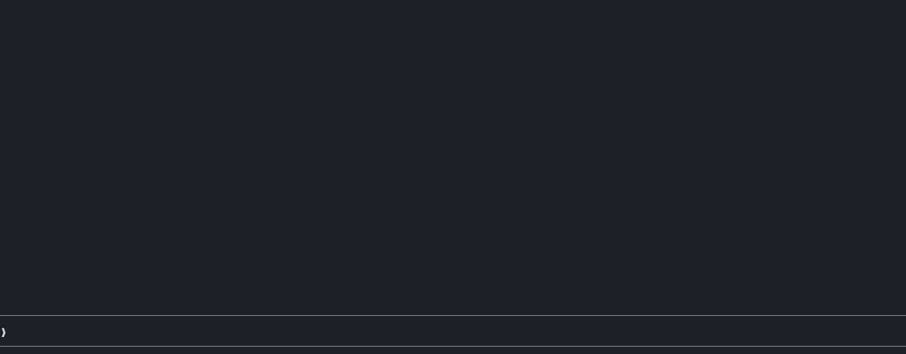

# clawd-logs

[](https://github.com/itsomidho/clawd-logs/releases) [](https://github.com/itsomidho/clawd-logs/wiki)

Watches your project's error logs while you work with [Claude Code](https://claude.com/claude-code). New errors show above the prompt, grouped, with a **Fix** button. When an error appears while Claude is working, Claude reads it right after its next tool call, so it notices what its change broke, even when the page or command only said "There has been a critical error on this website".



<sub>Recorded: the same fatal error is logged three times and shows as one row, ×3, with the file and line; **Fix** sends it, stack trace included, to Claude, which goes to find the missing function.</sub>

- **Finds the logs itself:** `wp-content/debug.log` (or Bedrock's `web/app/debug.log`) in the project or a folder above it, Laravel's `storage/logs/laravel.log`, and a [wpdev](#wpdev)-style stack's nginx error log for the site. Add any other file in a config file.
- **Only what's new:** each log is read from where it ended when the session started. A rotated or emptied log is read again from its start.
- **Grouped:** errors that differ only in values, ids, URLs or numbers are one line with a count, so 2,000 `Duplicate entry '…'` lines are one row `×2000`.
- **Levels:** fatal, error, warning, notice. Notices and deprecations are hidden by default.
- **Tells Claude:** errors that appear during a turn are attached to what Claude reads after the tool call that caused them, with the first one's stack trace. Errors from before the turn are not.

## Install

In Claude Code, type:

```
/plugin install clawd-logs --marketplace itsomidho/claude-plugins
```

Or try it from a checkout: `claude --plugin-dir path/to/clawd-logs`.

## The band

```
╭────────────────────────────────────────────────────────────────────────────────────────────────────────────────────────╮
│  FATAL  2 new errors · Fatal Uncaught Error: Call to undefined function foo() · src/Foo.php:42 ×3  Fix  Debug  Dismiss │
╰────────────────────────────────────────────────────────────────────────────────────────────────────────────────────────╯
```

It is framed like [clawd-statusbar](https://github.com/itsomidho/clawd-statusbar)'s section. On a narrow screen the message is cut first, so the file and line stay readable.

**Fix** sends the error and its stack trace to Claude. **Debug**, shown when [clawd-debug](https://github.com/itsomidho/clawd-debug) is installed and the error points at a PHP, Python or JavaScript file and line, opens that file in the debugger with a breakpoint on the line; press `t` there for a run with test data. **Dismiss** hides the band until the next new error. It sits with [clawd-guard](https://github.com/itsomidho/clawd-guard)'s band and [clawd-git](https://github.com/itsomidho/clawd-git)'s panel when you have them.

## Commands

| | |
|---|---|
| `/logs` | The new errors this session, newest first, and the files being watched |
| `/logs fix <n>` | Puts a fix request for error *n* in the prompt box, to send with Enter |
| `/logs clear` | Empties the list |
| `/logs off` / `/logs on` | Pauses or resumes watching for this session |

## Settings

Under `/config` → clawd-logs:

| Setting | Default | |
|---|---|---|
| Show from level | warning | `fatal`, `error`, `warning` or `notice` |
| Tell Claude | on | Attach new errors to Claude's tool results during a turn |
| Check every (seconds) | 2 | While Claude is idle; logs are also checked after each tool call |

## Config file

`~/.claude/clawd-logs.json` for every project, `.claude/clawd-logs.json` for one. The project's wins.

```json
{
  "sources": ["storage/logs/worker.log", "~/logs/php-fpm.log"],
  "minLevel": "error",
  "tellClaude": true
}
```

Relative paths are from the project folder.

## wpdev

With a stack laid out as `<stack>/sites/<site>` and nginx logs in `<stack>/logs/nginx/<site>_error.log`, a session in a site (or a theme or plugin inside it) watches that site's `debug.log` and its nginx error log. File paths from inside the PHP container (`/var/www/<site>/…`) are shown from the project folder.

## Good to know

- Logs are read with `tail -c`, at most 512 KB per check. After a burst larger than that, only the newest part is read.
- A log that does not exist yet is picked up once it does, as long as its folder exists (`wp-content/`).
- Nothing leaves your machine: no network, no tools to install.

## The clawd family

clawd-logs is one of seven plugins in the [`itsomidho` marketplace](https://github.com/itsomidho/claude-plugins); each works on its own:

- [clawd-statusbar](https://github.com/itsomidho/clawd-statusbar): a framed status bar under the prompt: context, usage limits with reset times, git state, MR/PR pipeline status, and Clawd frying an egg while Claude works
- [clawd-tasks](https://github.com/itsomidho/clawd-tasks): a live task board: Claude's plan, and under each task the steps it took, how long it ran, the files it changed and the agents it started
- [clawd-guard](https://github.com/itsomidho/clawd-guard): a safety net: stops risky shell commands, writes to secret files and leaked keys before they run
- [clawd-notify](https://github.com/itsomidho/clawd-notify): tells you when Claude is done or needs you: a desktop notification, a chime, and optionally a push to your phone
- [clawd-git](https://github.com/itsomidho/clawd-git): a live git panel beside the conversation: the file tree, changes, colored diffs and the commit graph; marks what Claude changed, stages, commits and asks Claude to review
- [clawd-debug](https://github.com/itsomidho/clawd-debug): a step debugger beside the conversation: set a breakpoint, let Claude run your code with test data, and step line by line while every variable and line value shows

## License

MIT
